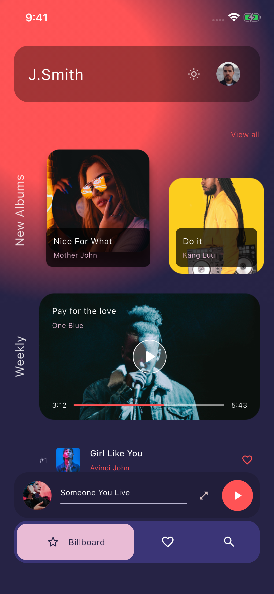
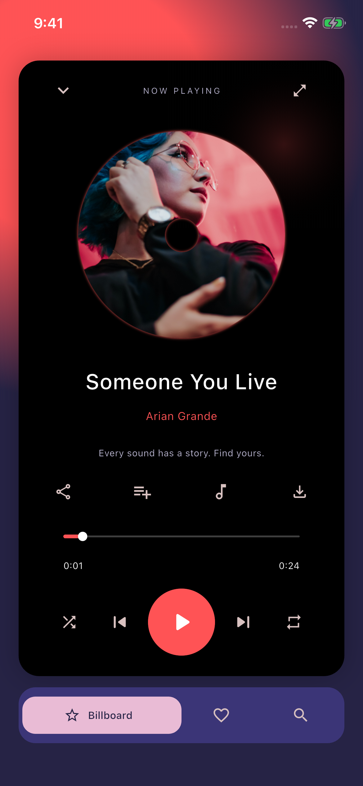
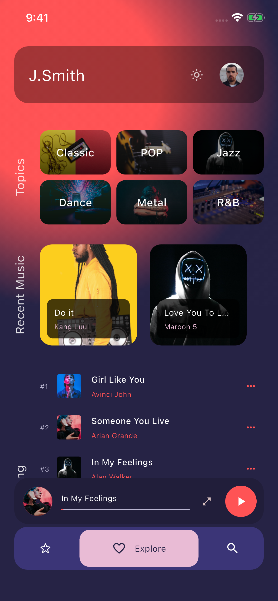
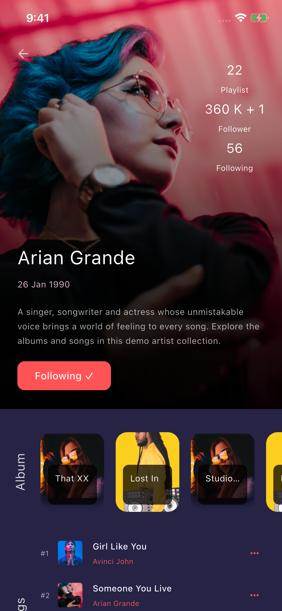
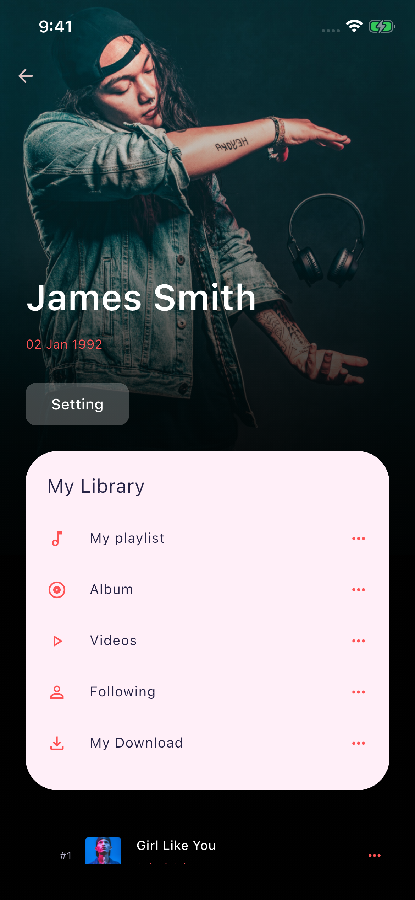
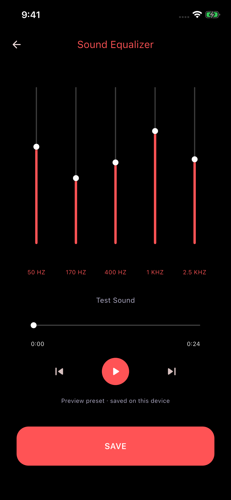

# Elexto · Flutter 音乐 App

根据 Pixso 文件 **Elexto - Music App UI Kit / Elexto** 开发的 Flutter 音乐应用。包含深色、浅色主题，覆盖原稿 36 个界面及交互状态，并补充可操作的本地音乐库。

保留原稿的珊瑚红、深紫、粉色、圆角卡片、纵向栏目标题和唱片播放器。插画、音乐封面、人物照片均从当前 Pixso 文件导出，随项目打包，无需在线加载。

## 主要界面

以下图片来自 iPhone 16e / iOS 26 模拟器的实际运行截图。

| 音乐首页 | 唱片播放器 | 探索分类 |
| --- | --- | --- |
|  |  |  |

| 艺人详情 | 个人中心 | 均衡器 |
| --- | --- | --- |
|  |  |  |

## 已实现

- 四页引导，登录、注册、手机验证、验证码、忘记密码和修改密码界面。
- 首页推荐、横向专辑、每周推荐、最近音乐与底部迷你播放器。
- 搜索、过滤、搜索空状态、艺人及视频分类。
- 本地音频播放、暂停、上一首/下一首、随机播放、单曲循环、进度拖动。
- 播放队列、歌词展示、收藏、加入歌单、离线预览标记和复制曲目链接。
- 艺人关注、专辑、视频海报详情、建议列表和示例评论。
- 分类瀑布布局、歌单创建、复制、重命名、删除与空状态。
- 个人中心、收藏/下载/关注列表、主题切换、五段均衡器预设保存。
- 主题、演示会话、歌单、收藏、关注、下载标记与均衡器参数本地持久化。

## 运行

环境：Flutter 3.41.6 / Dart 3.11.4。项目包含 iOS、Android、Web 工程。

```bash
flutter pub get
flutter run
```

指定平台：

```bash
flutter run -d <iOS或Android设备ID>
flutter run -d chrome
```

首次打开显示引导页。点击四次 NEXT 后进入登录，使用默认邮箱与任意不少于 6 位的密码，例如 `demo123`。注册页默认邮箱会触发“邮箱已使用”示例，修改为其他合法邮箱即可继续。演示验证码为 **2828**，有效期 30 秒，过期可以重发。

首页右上角太阳/月亮图标、个人设置的 Dark appearance 开关均可切换主题。歌单从个人中心 → My playlist 管理；播放页的加入歌单按钮将当前曲目保存到所选歌单。

## 项目结构

```text
lib/
├── main.dart                         # 初始化持久化数据并启动
├── app.dart                          # 主题与命名路由
├── core/
│   ├── app_controller.dart           # 播放、会话、音乐库状态
│   └── app_theme.dart                # 两套主题与设计色值
├── data/
│   ├── catalog.dart                  # 曲目与分类模型、演示目录
│   └── preference_store.dart         # 本地存储边界及测试内存实现
├── features/
│   ├── auth/
│   │   ├── welcome_screen.dart       # 引导、加载、完成
│   │   └── auth_screen.dart          # 账号表单、验证、改密
│   ├── music/
│   │   ├── home_screen.dart          # 首页、探索、搜索
│   │   ├── player_screen.dart        # 播放、队列、歌词、歌单与分享弹层
│   │   └── detail_screens.dart       # 艺人、视频、分类
│   └── library/
│       └── library_screens.dart      # 歌单、个人中心、设置、均衡器
└── widgets/
    └── ui.dart                        # 按钮、图片、歌曲行、播放控制等
assets/
├── images/                           # Pixso 导出的本地素材
└── audio/                            # 三段原创 24 秒演示音频
integration_test/app_flow_test.dart    # 原生模拟器端到端流程
scripts/capture_simulator.py           # 运行流程测试并逐页截图
```

详细分层、数据流、路由、设计稿对应关系见 [架构说明](docs/ARCHITECTURE.md)。全部运行截图见 [界面截图索引](docs/SCREENSHOTS.md)，Pixso 原稿参考保存在 [docs/design](docs/design)。

## 验证与构建

已通过静态检查、8 项单元/界面测试及深浅主题完整 iPhone 模拟器流程；已构建 iOS 模拟器版、Web 发布版和 Android 分架构发布包。详见 [验证记录](docs/VALIDATION.md)。

Android 手机可安装 [ARM64 演示 APK](build/app/outputs/flutter-apk/app-arm64-v8a-release.apk)。

```bash
flutter analyze
flutter test
flutter build ios --simulator --debug
flutter build web --release
flutter build apk --release --split-per-abi
```

运行真实模拟器流程并重新截图（需要 macOS、Xcode 与已启动的 iOS 模拟器）：

```bash
python3 scripts/capture_simulator.py <模拟器UUID>
```

脚本执行 `integration_test/app_flow_test.dart`，通过 `xcrun simctl io screenshot` 保存未经合成的实际屏幕图片，覆盖引导、键盘、搜索、播放、队列、歌词、弹窗、歌单、艺人、个人设置和浅色主题。截图目录为 `docs/screenshots/`，日志为 `docs/simulator-test.log`。

## 演示范围与后端接入

这是可运行、可交互的本地 UI 演示工程。登录、注册、验证码和修改密码不连接真实账号服务，密码和验证码不会写入本地存储。曲名、艺人和封面沿用设计稿；实际播放的是项目自带的原创短音频，并非这些商业歌曲的录音。

视频详情使用原稿海报与本地音频预览，不包含真实视频流。歌词及评论为展示数据。下载操作将已打包的短音频加入离线预览列表；复制操作写入本地 `elexto://track/<id>` 演示链接，尚未注册外部深链。均衡器保存五段滑杆预设，目前未接入系统 DSP 音频处理。

后续可以在 `data/` 接入认证 API、流媒体目录、分页搜索和远程下载服务，并在 `AppController` 保留现有 UI 调用接口。

播放与存储依赖使用 [audioplayers](https://pub.dev/packages/audioplayers) 和 [shared_preferences](https://pub.dev/packages/shared_preferences)，原生图标补充使用 `cupertino_icons`。状态管理使用 Flutter 自带的 `ChangeNotifier` 与 `InheritedNotifier`。
