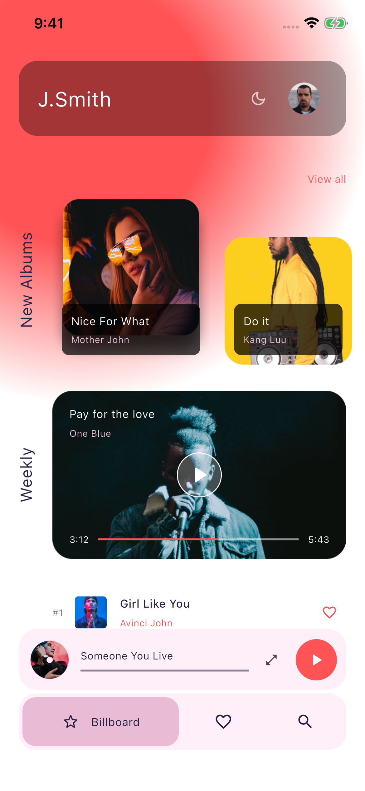
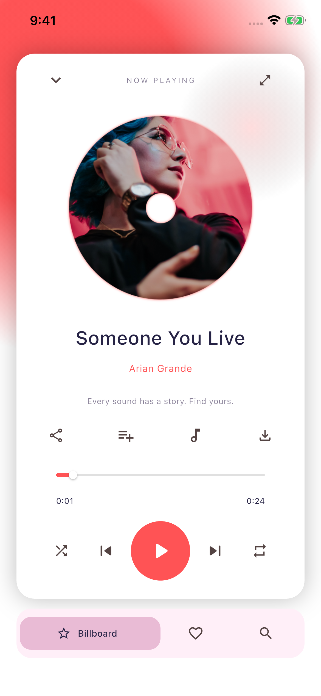

# 运行界面截图索引

截图设备：Elexto QA / iPhone 16e，iOS 26.0。每个检查点分别保存 Dark、Light 两个版本，共 76 张实际运行 PNG。由集成测试配合 `xcrun simctl io screenshot` 捕获，包含系统键盘和弹层。

| 序号 | 界面 / 状态 | 深色运行截图 | 浅色运行截图 |
| --- | --- | --- | --- |
| 01 | 引导一 | [查看](screenshots/01-welcome-dark.png) | [查看](screenshots/01-welcome-light.png) |
| 02 | 引导二 | [查看](screenshots/02-welcome-dark.png) | [查看](screenshots/02-welcome-light.png) |
| 03 | 引导三 | [查看](screenshots/03-welcome-dark.png) | [查看](screenshots/03-welcome-light.png) |
| 04 | 引导四 | [查看](screenshots/04-welcome-dark.png) | [查看](screenshots/04-welcome-light.png) |
| 05 | 登录 | [查看](screenshots/05-login-dark.png) | [查看](screenshots/05-login-light.png) |
| 06 | 注册与邮箱错误 | [查看](screenshots/06-signup-dark.png) | [查看](screenshots/06-signup-light.png) |
| 07 | 手机号空状态 | [查看](screenshots/07-phone-empty-dark.png) | [查看](screenshots/07-phone-empty-light.png) |
| 08 | 手机号输入与键盘 | [查看](screenshots/08-phone-filled-dark.png) | [查看](screenshots/08-phone-filled-light.png) |
| 09 | 忘记密码 | [查看](screenshots/09-forgot-dark.png) | [查看](screenshots/09-forgot-light.png) |
| 10 | 验证码与数字键盘 | [查看](screenshots/10-verification-dark.png) | [查看](screenshots/10-verification-light.png) |
| 11 | 加载 | [查看](screenshots/11-loading-dark.png) | [查看](screenshots/11-loading-light.png) |
| 12 | 完成 | [查看](screenshots/12-success-dark.png) | [查看](screenshots/12-success-light.png) |
| 13 | 首页 | [查看](screenshots/13-home-dark.png) | [查看](screenshots/13-home-light.png) |
| 14 | 首页滚动内容 | [查看](screenshots/14-home-scrolled-dark.png) | [查看](screenshots/14-home-scrolled-light.png) |
| 15 | 搜索默认 | [查看](screenshots/15-search-dark.png) | [查看](screenshots/15-search-light.png) |
| 16 | 搜索焦点与键盘 | [查看](screenshots/16-search-focused-dark.png) | [查看](screenshots/16-search-focused-light.png) |
| 17 | 歌曲搜索 | [查看](screenshots/17-search-all-dark.png) | [查看](screenshots/17-search-all-light.png) |
| 18 | 艺人搜索 | [查看](screenshots/18-search-artist-dark.png) | [查看](screenshots/18-search-artist-light.png) |
| 19 | 视频搜索 | [查看](screenshots/19-search-video-dark.png) | [查看](screenshots/19-search-video-light.png) |
| 20 | 视频操作菜单 | [查看](screenshots/20-video-actions-dark.png) | [查看](screenshots/20-video-actions-light.png) |
| 21 | 播放器 | [查看](screenshots/21-player-dark.png) | [查看](screenshots/21-player-light.png) |
| 22 | 播放队列 | [查看](screenshots/22-player-queue-dark.png) | [查看](screenshots/22-player-queue-light.png) |
| 23 | 加入歌单提示 | [查看](screenshots/23-added-to-playlist-dark.png) | [查看](screenshots/23-added-to-playlist-light.png) |
| 24 | 歌词 | [查看](screenshots/24-lyrics-dark.png) | [查看](screenshots/24-lyrics-light.png) |
| 25 | 歌单选择 | [查看](screenshots/25-playlists-dark.png) | [查看](screenshots/25-playlists-light.png) |
| 26 | 分享 | [查看](screenshots/26-share-dark.png) | [查看](screenshots/26-share-light.png) |
| 27 | 艺人详情 | [查看](screenshots/27-artist-dark.png) | [查看](screenshots/27-artist-light.png) |
| 28 | 视频海报详情 | [查看](screenshots/28-video-dark.png) | [查看](screenshots/28-video-light.png) |
| 29 | 探索 | [查看](screenshots/29-explore-dark.png) | [查看](screenshots/29-explore-light.png) |
| 30 | 音乐分类 | [查看](screenshots/30-genres-dark.png) | [查看](screenshots/30-genres-light.png) |
| 31 | 歌单详情 | [查看](screenshots/31-folder-dark.png) | [查看](screenshots/31-folder-light.png) |
| 32 | 歌单设置 | [查看](screenshots/32-folder-settings-dark.png) | [查看](screenshots/32-folder-settings-light.png) |
| 33 | 个人中心 | [查看](screenshots/33-profile-dark.png) | [查看](screenshots/33-profile-light.png) |
| 34 | 用户设置 | [查看](screenshots/34-settings-dark.png) | [查看](screenshots/34-settings-light.png) |
| 35 | 修改密码 | [查看](screenshots/35-password-dark.png) | [查看](screenshots/35-password-light.png) |
| 36 | 均衡器 | [查看](screenshots/36-equalizer-dark.png) | [查看](screenshots/36-equalizer-light.png) |
| 37 | 本地歌单与收藏入口 | [查看](screenshots/37-library-dark.png) | [查看](screenshots/37-library-light.png) |
| 38 | 离线预览列表 | [查看](screenshots/38-downloads-dark.png) | [查看](screenshots/38-downloads-light.png) |

## 主要界面对照

| 首页 · 深色 | 首页 · 浅色 |
| --- | --- |
|  |  |

| 播放 · 深色 | 播放 · 浅色 |
| --- | --- |
|  |  |

设计稿参考图位于 [design](design)，运行截图位于 [screenshots](screenshots)。两个目录用途独立；此文档没有将设计参考图作为应用运行截图。
